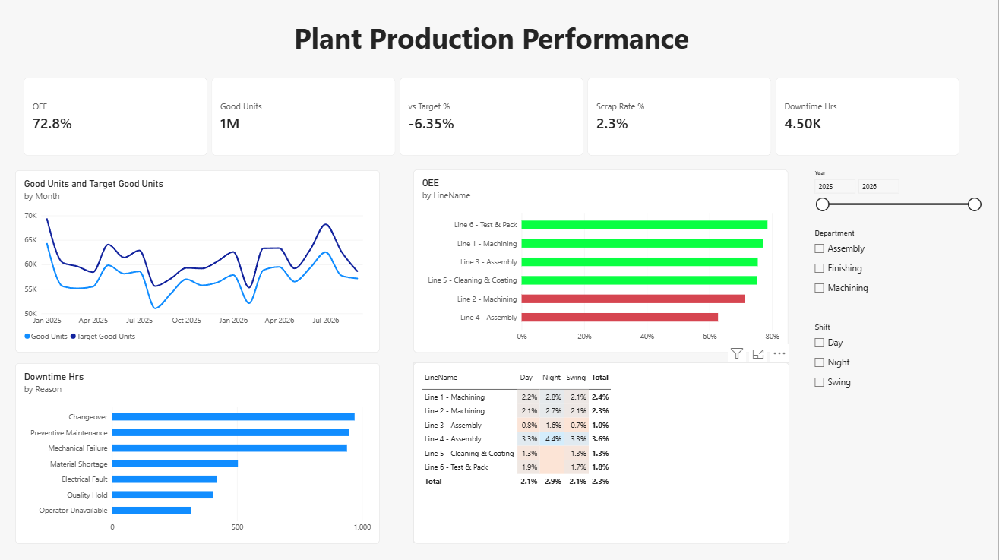

# Manufacturing Production Performance Dashboard (Power BI)

A one-page Power BI dashboard that tracks production output, quality, downtime and OEE for a multi-line manufacturing plant.

> **Note:** All data in this project is **synthetic** (generated for practice). It does not contain any real company data.



## Business questions answered
- Are we hitting our monthly production targets?
- Which production line has the lowest OEE and the highest scrap?
- Which shift performs worst?
- What causes the most downtime?

## Dataset
| Table | Type | Description |
|---|---|---|
| Production | Fact | One row per line, shift and day: planned vs produced units, scrap, run minutes |
| Downtime | Fact | Stop events with reason and minutes |
| Targets | Fact | Monthly targets per line (good units, scrap rate, OEE, budget cost) |
| Lines, Products, Shifts | Dimension | Lookup tables |
| Date | Dimension | DAX calendar table, marked as date table |

Period: Jan 2025 – Sep 2026 · 6 lines · 3 shifts · ~7,800 production records

## What I did
**1. Data cleaning (Power Query)**
- Removed 35 duplicate production rows
- Fixed mixed date formats using locale-aware type conversion
- Trimmed trailing spaces that split product families into duplicates
- Replaced blank Operator IDs with "Unknown" (kept the rows so totals stay accurate)
- Set correct data types (fixed decimal for money, whole numbers for counts)

**2. Data model**
- Star schema with three fact tables and four dimensions
- One-to-many, single-direction relationships
- Dedicated `_Measures` table

**3. DAX measures**
```DAX
Good Units    = [Units Produced] - [Scrap Units]
Scrap Rate %  = DIVIDE([Scrap Units], [Units Produced])
vs Target %   = DIVIDE([Good Units], [Target Good Units]) - 1
Availability  = DIVIDE(SUM(Production[RunMinutes]), SUM(Production[PlannedMinutes]))
Performance   = DIVIDE(SUMX(Production, Production[UnitsProduced] / Production[IdealRatePerHour] * 60), SUM(Production[RunMinutes]))
Quality       = DIVIDE([Good Units], [Units Produced])
OEE           = [Availability] * [Performance] * [Quality]
Production Cost = SUMX(Production, Production[UnitsProduced] * RELATED(Products[StandardCost]))
```

**4. Dashboard**
- KPI cards: OEE, Good Units, vs Target %, Scrap Rate %, Downtime Hours
- Good Units vs Target trend by month
- OEE by line with conditional formatting against the 75% target
- Downtime hours by reason
- Scrap rate heat map by line and shift
- Slicers for year, department and shift

## Key insights
- **Overall OEE is 72.8%**, below the 75% target; output is ~6% below target and misses it every month.
- **Line 4 (Assembly)** is the weakest line: highest scrap (3.6%) and lowest OEE; its night shift reaches 4.4% scrap.
- **Night shift** has the highest scrap rate (2.9% vs 2.1% on day and swing).
- **Changeover** is the top downtime reason, closely followed by preventive maintenance and mechanical failure. Reducing changeover time is the quickest win.

## Files
| File | Description |
|---|---|
| `Production_Dashboard.pbix` | Power BI report (open with Power BI Desktop) |
| `data/` | Source CSV files |
| `dashboard.png` | Dashboard screenshot |

## Tools
Power BI Desktop · Power Query · DAX
#
